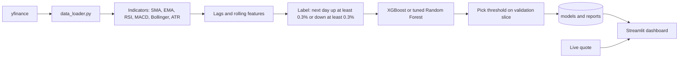

# AI Financial Analyst Dashboard

A Streamlit dashboard that downloads market data, computes technical indicators, and trains a model per ticker to predict whether the next day's move will be up or down. It covers US tech, financial and energy stocks, crypto, and a few Indian stocks. Each prediction is shown with charts, a live quote, and a simple options idea based on the signal and volatility.

## Results

I trained one model for each of 26 tickers and tested it on the most recent 20% of each history, which the model never saw.

| Metric | Value |
|---|---|
| Tickers | 26 across tech, financials, energy, crypto and India |
| Average test AUC | **0.51** |
| AUC range | 0.45 to 0.58 |
| Best ticker | MSFT at 0.58 AUC |

**What this means:** next day direction from price based indicators is close to a coin flip. An AUC of 0.51 is barely above random. That matches what market efficiency predicts, since public price patterns are quickly traded away. I kept the evaluation strict, with time ordered splits and a threshold picked on a separate validation slice, so these numbers are honest rather than flattering. Treat the signals as a learning tool, not trading advice.

Full reports per ticker are in `reports/`.

## How it works



1. **Download.** `data_loader.py` pulls daily OHLCV data from Yahoo Finance for a sector group or any list of tickers, including NSE and BSE symbols.
2. **Indicators.** It adds SMA, EMA, RSI 14, MACD, Bollinger Bands and ATR 14.
3. **Features.** `model_trainer.py` adds lagged values and rolling statistics.
4. **Label.** A day counts as up if the next close is at least 0.3% higher and down if it is at least 0.3% lower. Smaller moves are dropped as noise.
5. **Train.** XGBoost is used when installed. Otherwise a Random Forest is tuned with time series cross validation.
6. **Threshold.** The decision threshold is chosen for best F1 on the last 15% of training data, then the model is scored once on the test set.
7. **Dashboard.** Pick a stock or a sector, see price, RSI and MACD charts, the model's probability of an up day, and a suggested options strategy.

## Dashboard

* **Single stock mode** shows candles with indicators, the up or down signal, P(up), ATR, a live quote that can refresh every 60 seconds, and a strategy idea.
* **Sector mode** averages the signals across all names in a sector.
* **Strategy rules** are simple: P(up) of 0.6 or more suggests a bull call spread, 0.4 or less a bear put, and high volatility with no clear direction a long straddle.

## Tech stack

| Area | Tools |
|---|---|
| Data | yfinance, pandas, ta |
| Modeling | XGBoost, scikit-learn Random Forest, TimeSeriesSplit |
| App | Streamlit, Plotly |

## Project structure

```
data_loader.py         Download prices and compute indicators
model_trainer.py       Features, labels, training, threshold and reports
dashboard_app.py       Streamlit dashboard
realtime_provider.py   Live quote from yfinance
data/                  Price data per ticker
models/                Trained model per ticker
reports/               Test metrics per ticker
```

## Running it

```bash
pip install -r requirements.txt

python data_loader.py --sector Tech --start 2016-01-01 --end 2025-01-01
python model_trainer.py --tickers AAPL MSFT NVDA GOOGL AMZN META ADBE ORCL

streamlit run dashboard_app.py
```

Sector groups are Tech, Financials, Energy and Crypto. Pass `--tickers` to `data_loader.py` for any other symbols.

## What I would try next

* Add features beyond price, such as earnings dates, news sentiment or market wide factors
* Predict over longer horizons, where signals tend to be stronger than one day
* Backtest the strategy rules with trading costs instead of judging by AUC alone

## Author

Siddhesh Patil, MS in Artificial Intelligence, DePaul University
